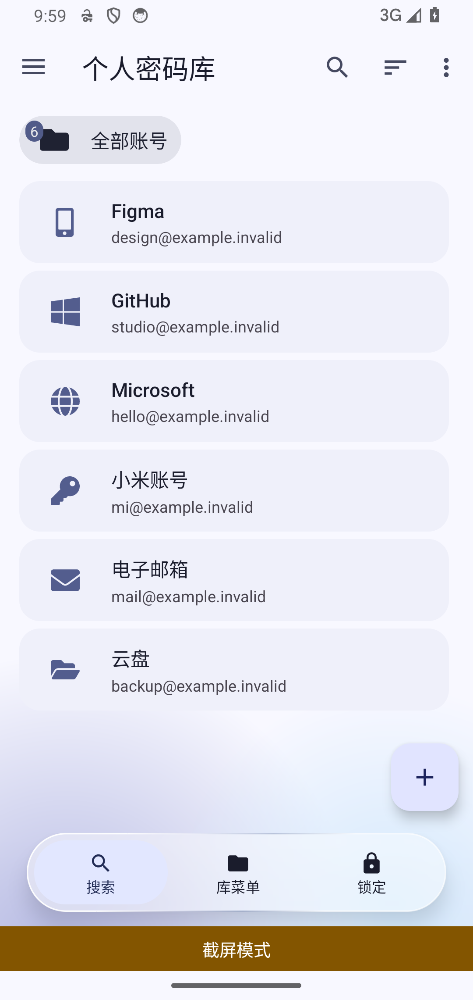
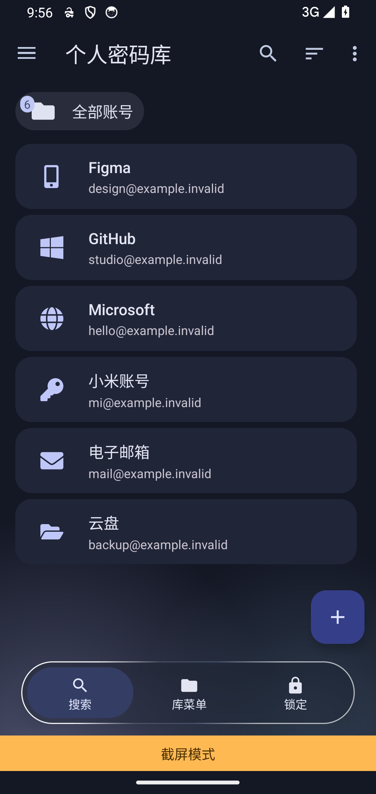
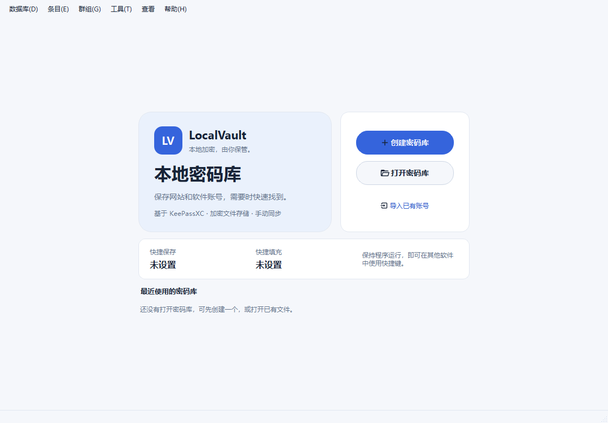
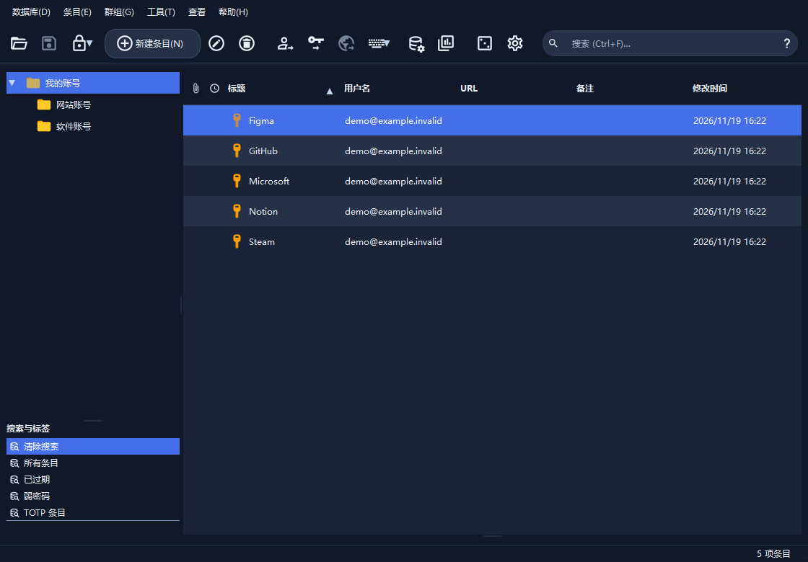
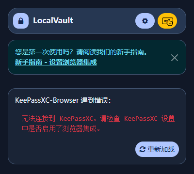
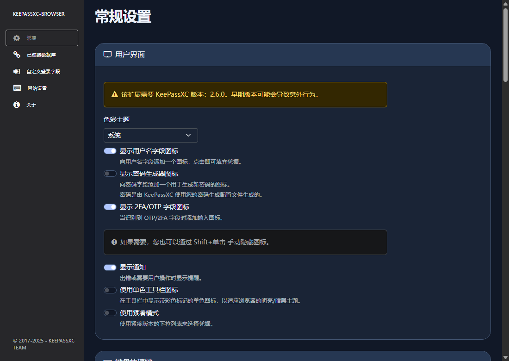

# LocalVault 本地密码库

在 Windows、Android 和浏览器里管理网站与软件账号。LocalVault 使用标准 KDBX 4 加密文件，文件存放和同步由你决定。项目复用 KeePassXC、KeePassDX 和 KeePassXC-Browser，提供中文使用说明以及适合各平台的界面。

[下载新版 Android 界面预览 APK](https://github.com/TaotaoByte/password-manager/releases/tag/v0.3.0-android) · [Windows 便携包与 Chromium 扩展](https://github.com/TaotaoByte/password-manager/releases/latest) · [从这里开始](00-先看这里.md) · [兼容性与验收](docs/COMPATIBILITY.md)

## 界面预览

Android 是优先维护的客户端。账号页使用统一的标题、账号名、分组和导航字号，支持浅色及深色。底部玻璃栏可搜索、打开库菜单或锁定。

| Android 浅色 | Android 深色 |
| --- | --- |
|  |  |

玻璃栏只对界面装饰背景取样。Android 13 及以上通过原生着色器绘制模糊和弧边折射，Android 12 使用原生模糊，Android 11 使用半透明底色。所有版本都使用独立的文字和图标层。设计参考 Apple 的材质指南和 Google 的 Material 3 排版。

[Apple 材质指南](https://developer.apple.com/design/human-interface-guidelines/materials) · [Material 3 排版](https://m3.material.io/styles/typography/overview)

Windows 首页把创建、打开和导入放在右侧，左侧显示密码库介绍。账号列表支持搜索与分组，默认使用 Windows 的应用颜色模式。





Chromium 扩展的弹窗和设置页使用相同的配色与圆角。扩展内的颜色偏好仍可手动选择。





截图由 Windows 测试程序、Android 14 模拟器与独立 Chromium 配置生成，显示的账号与密码库均为虚构数据。Android 截图底部的“截屏模式”提示来自演示设置，默认安装不会开启。

## 安装

| 平台 | 文件 | 操作 |
| --- | --- | --- |
| Windows 11 x64 | `LocalVault-Windows-x64.zip` | 完整解压，启动 `KeePassXC.exe`。从完整项目目录使用时可双击 `启动密码管理器.cmd`。 |
| Android | `LocalVault-Android-test.apk` | 传到手机，使用 Android 安装界面安装。此包是可调试的测试签名版本。个人长期使用可按说明自行构建并持久保存签名。 |
| Edge / Chrome | `KeePassXC-Browser-1.10.4.1-Chromium.zip` | 解压，用浏览器开发者模式加载。把该扩展的 ID 添加到 Windows 客户端的浏览器集成高级设置，然后确认配对。 |

[Windows 快捷键与浏览器连接](docs/WINDOWS-SETUP.zh-CN.md) · [Android 安装、HyperOS 设置与同步](docs/ANDROID-SETUP.zh-CN.md) · [构建和签名](docs/BUILD.md)

也可以使用官方 KeePassXC-Browser 商店扩展，它使用上游界面。使用定制扩展时，请只授权自己从发布页解压并加载的扩展 ID。

## 日常使用

1. 在 Windows 或 Android 创建一个密码库，设置自己的主密码。将 `.kdbx` 文件放在个人数据目录。
2. 在 Windows 打开密码库。切换到要录入的软件，按 **Ctrl+Alt+S**，填写并确认。程序可以记录窗口标题，用于以后匹配。按 **Ctrl+Alt+A** 查找并填充匹配条目，默认不提交表单。
3. 浏览器配对后，可使用扩展匹配网站账号、填充表单及确认新增和更新。Android 在系统设置中选择 LocalVault 的自动填充服务，系统会在支持的应用与网页提供候选项。
4. 要在两端同步，传递加密的 KDBX 文件。两端分别修改过时，在 Windows 先做备份，再合并两份库并将结果传回手机。保留旧文件，直到确认合并结果。

还可按分组整理账号、搜索、生成密码、查看条目历史、锁定密码库和清理应用复制的剪贴板内容。密码数据由本地应用处理。

## 设备与验证范围

| 平台 | 当前范围 |
| --- | --- |
| Windows 11 x64 | 验证了浅色、深色和小窗口布局，以及新增、搜索、锁定、备份、合并等回归流程。 |
| Android | 目标为 Android 11 及以上。新版界面在 Android 14 模拟器检查。首版已有 Android 11、14、17 启动记录，以及 Android 11 自动填充记录。 |
| 红米 K80 Pro | 首要实机验收设备。具体 HyperOS 版本、后台限制和键盘候选行为仍待实机验证。 |
| Edge / Chrome | 定制包继承 KeePassXC-Browser 的匹配与配对逻辑。检查范围和待复测项见验收记录。 |

[详细测试记录](docs/VALIDATION.md)

## 源码目录

| 路径 | 内容 |
| --- | --- |
| `docs/` | 使用、构建和设备测试说明 |
| `patches/` | 三端相对上游的修改 |
| `scripts/` | 恢复固定源码、编译、打包和校验工具 |
| `tests/` | 使用虚构数据的测试夹具 |
| `upstream.lock.json` | 三个上游项目的版本和精确提交号 |

克隆仓库后，在 Windows PowerShell 里恢复源码，再按需构建。

```powershell
git clone https://github.com/TaotaoByte/password-manager.git
Set-Location password-manager
./scripts/Restore-Sources.ps1
./scripts/Build-Windows.ps1
./scripts/Build-Android.ps1 -JavaHome '<JDK 17 或 21 的路径>' -AndroidSdk '<Android SDK 路径>'
./scripts/Package-Browser.ps1
./scripts/Write-Checksums.ps1
```

工具链和签名配置见 [构建说明](docs/BUILD.md)。恢复后的源码位于 `upstream/`，构建结果位于 `dist/`。发布包在 GitHub Releases 提供。

## 上游和许可证

| 项目 | 固定版本 | 用途 |
| --- | --- | --- |
| [KeePassXC](https://github.com/keepassxreboot/keepassxc) | 2.8.0 | Windows 客户端 |
| [KeePassDX](https://github.com/Kunzisoft/KeePassDX) | 4.5.8 | Android 客户端 |
| [KeePassXC-Browser](https://github.com/keepassxreboot/keepassxc-browser) | 1.10.4.1 | 浏览器扩展 |

LocalVault 是独立维护的定制版。上游版权、许可证与许可说明随源码保留。界面参考 Google 的 Material Design 3。

[开源许可与版权说明](LICENSE.md) · [Material Design 3](https://m3.material.io/)
